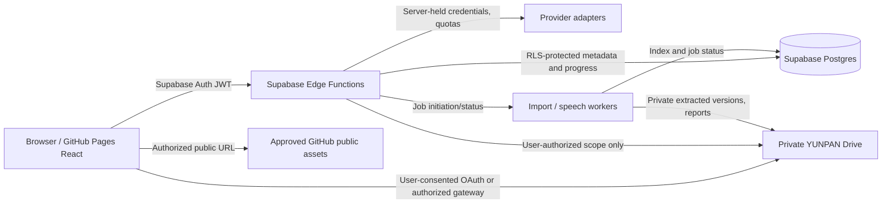

# Runtime architecture and frontend data contracts — V3

**Design proposal, not an implemented backend.** The existing `src/` frontend, PR #3 and the separate Codex import branch remain untouched.

## Deployment and security boundary



`ACIDCH.github.io` is **not a dependency**. Hosted project path `/language-learning-hub/`; never replace root Pages site.

Data ownership:
- GitHub: public code and individually cleared, explicitly published original/demo learning assets.
- Google Drive/YUNPAN: private source-of-truth for owner-imported PDF/audio, full original materials and derivative lesson packages. Contents remain private regardless of Github repo visibility.
- Supabase: Auth, normalized metadata, user progress, rights + provenance, job states. Do not store raw full textbooks/audio in relational DB.
- Background workers: optional long-running extraction and pronunciation models; **Edge Functions are orchestration/auth gateway**, not assumed to host large PDFs or heavy audio inference.

## Frontend layers

```
AppRouter
  AppShell
    CourseArea
      CourseNavigation
      UnitList
      LessonReader
        SixStageNav
        OriginalSourceViewer
        StructuredContentView
        AudioResources
        PracticeOutput
        TutorContext
    PersonalLibraryArea
      MaterialUploader
      DriveInboxLink
      ImportQueue
      SourceToLessonReview
    SourceCatalogArea
    AIWorkspace
    Settings
  DataAdapters
    CourseCatalogPort / LessonContentPort
    AssetResolver / ProvenancePort
    ImportJobsPort
    UserProgressPort
    AIProviderPort / PronunciationPort
  AuthSession + PermissionBoundary
```

Architecture rule: React components cannot know whether an asset came from Drive, a legal public Github asset or a linked third-party teaching site. `AssetResolver` owns authorization and access.

## Core models (pseudocode contracts)

```ts
type LanguageCode = string; // BCP-47 tag: en, fr, es, ja, zh-CN ...
type RightsClass =
  | 'project_original_public'
  | 'open_redistributable'
  | 'personal_licensed_private'
  | 'external_link_only'
  | 'rights_review_required';

type AssetRef = {
  id: string;
  mimeType: string;
  storageKind: 'github_public' | 'google_drive_private' | 'external_link';
  rightsClass: RightsClass;
  originalUrl?: string;        // validated HTTPS for external links
  storageLocator?: string;     // never publicize a private bearer link
  byteLength?: number;
  sha256?: string;
  sourceId?: string;
  licenseLabel?: string;
  attribution?: string;
  visibility: 'public' | 'owner_private';
  revision: string;
  verifiedAt?: string;
};

type LessonBlock = {
  id: string;
  stage: 'context' | 'grammar' | 'vocabulary' |
    'reception' | 'pronunciation' | 'production' | 'appendix';
  ordinal: number;
  kind: 'paragraph' | 'heading' | 'table' | 'example' |
    'exercise' | 'answer' | 'image' | 'source-link' |
    'audio-reference' | 'footnote';
  content: unknown;            // validated structured blocks, not trusted arbitrary HTML
  sourceSpan?: { documentId: string; page?: number; chapter?: string; paragraph?: number };
  assetRefs?: string[];
};

type LessonDocument = {
  id: string;
  language: LanguageCode;
  title: string;
  level?: string;              // French CEFR, or cross-map for English
  skillTrack?: string;         // IELTS-style tracks
  learningObjective: string;
  status: 'outline' | 'draft' | 'media_pending' | 'reviewed' | 'published';
  original: AssetRef;          // required for personal imported lessons
  blocks: LessonBlock[];
  originalBlockCount: number;
  extractedBlockCount: number;
  missingSourceSpans: string[];
  contentRevision: string;
  sourceReferences: string[];
};

type MediaAlignment = {
  audioAssetId: string;
  lessonId: string;
  chapterId?: string;
  trackNo?: string;
  transcriptAssetId?: string;
  wordTimings?: Array<{ word: string; startMs: number; endMs: number }>;
  alignmentMethod: 'human_verified' | 'automated_unverified';
  confidence?: number;
  status: 'missing' | 'proposed' | 'needs_review' | 'verified';
};

type ImportJob = {
  id: string;
  ownerId: string;
  inputAssetIds: string[];
  state: 'queued' | 'uploading' | 'uploaded' | 'validating' | 'extracting' |
    'mapping' | 'needs_review' | 'approved' | 'importing' |
    'completed' | 'failed' | 'cancelled';
  warnings: Array<{ code: string; sourceSpan?: string; message: string }>;
  originalItemCount?: number;
  mappedItemCount?: number;
  unmatchedAudioCount?: number;
  previewRevision?: string;
  createdAt: string;
  updatedAt: string;
};
```

### Invariants and consistency

- `LessonDocument.original` identifies the complete master copy; transformed blocks may never replace or delete it.
- A lesson is `published` only when all required blocks are present, media state corresponds to actual asset status, and source/reuse rights are reviewed.
- Compare expected and transformed paragraph/table/exercise/answer/footnote/page counts to detect losses. If extractor cannot recognize an image/chart, retain a source-page placeholder and flag manual review (not deletion).
- Supabase operations are owner-scoped with RLS; no front-end `service_role`, Google refresh token or model key.
- `ImportJob` transitions must be checked server-side; client cannot directly set `approved` or fake completion. Use idempotency key = owner + source file hash + version. A failed job is retryable without duplicating originals.
- Drive private resource IDs can be safely held in authorized server metadata but need not be exposed to anonymous users or in the public repo; external hrefs must be HTTPS allowlisted/protocol checked.
- User should choose when an import/AI job can be sent to a third-party model, and receive a clear privacy notice.

## Logical endpoints — proposed, not deployed

| Action | Proposed API | Auth | Result |
| --- | --- | --- | --- |
| catalog | `GET /api/v1/courses?language=fr` | optional public/owner | levels, skill tracks, readiness |
| lesson | `GET /api/v1/lessons/:id` | per-asset rights | original metadata, blocks, source refs |
| asset access | `POST /api/v1/assets/:id/resolve` | owner for private | restricted short-lived access (never publicized) |
| upload request | `POST /api/v1/imports/uploads` | owner | scoped upload session and size constraints |
| start import | `POST /api/v1/imports` | owner | job id, idempotency response |
| Drive Inbox scan | `POST /api/v1/imports/drive-scan` | owner + OAuth scope | newly detected authorized files |
| import review | `GET /api/v1/imports/:id/preview` | owner | diff, page-loss warnings, media mapping |
| approve | `POST /api/v1/imports/:id/approve` | owner + revision match | asynchronous private asset and lesson commit |
| job status | `GET /api/v1/imports/:id` | owner | state and resumable errors |
| update progress | `PUT /api/v1/progress/:unitId` | owner | bookmark and completion-at-own-pace |
| AI explanation | `POST /api/v1/tutor/explain` | owner + quota | scoped answer + passage cites |
| pronunciation | `POST /api/v1/speech/evaluate` | opt-in microphone + owner | per-word evidence/neutral errors; NO total score |

Use Supabase Edge Functions path mapping if the deployment architecture differs. These endpoints are interface designs and require an integration review before public launch.

## Import processing modes

- `manual_web_upload`: user-selected local files; preflight MIME, per-file/overall quotas, ZIP limits and path traversal defense.
- `manual_drive_scan`: scan exact private `03-Personal/00-Inbox` only; use durable `fileId/revision`, not filename matching as identity.
- `authorized_opt_in_sync`: if configured later, observe folder delta and use ETag/change token, never bulk rescan all Drive on every request.
- After successful review, keep immutable original under `01-Originals`; transformed structured assets under `02-Converted`, and detailed import reports under `03-Import-Reports`.
- PDF text layer first; OCR only for actual scans and with cost/quality controls; store page images/citations where OCR uncertainty remains.
- ZIP archives: virus scan, size/decompression-ratio limits, forbid `../` or absolute paths, and reject symlinks.
- Audio: match by embedded metadata, filename hints, track numbering, and/or transcript; high confidence **suggests** mapping, but user approval required for ambiguities.
- Privacy: no automatic publication to a public repo, no unknown external AI model upload without consent, no indefinite raw microphone storage.

## Failure scenarios

1. User not signed in → show login; do not reveal Drive names/files.
2. Source PDF encrypted → ask for lawful access; do not bypass DRM.
3. 300-page PDF partly extracted → keep entire original and report missing pages; don't mark content complete.
4. 40 MP3 files with same names → use content hash + parent/source metadata; ask user to resolve ambiguity.
5. OCR confuses French diacritics → show source-level diff and error confidence, with manual editing.
6. Network disconnect during upload → chunked/resumable state or clear retry; no silent success.
7. AI provider fails or exceeds budget → retain prior user content, show explicit status, let user retry.
8. User uploads another language → accept BCP-47 code if supported; allow custom curriculum definition instead of forcing into `en`/`fr`.
9. Live external resource link disappears → don't delete lesson; mark source unavailable and retain permitted cached copy if authorized.

## Minimum quality and privacy tests

- Verify two different accounts cannot access each other's private lesson/document metadata under Supabase RLS.
- Ensure anonymous site visitor cannot resolve `google_drive_private`.
- Upload and recover mixed PDF + MP3 + SRT using a test pack; preserve original binary hashes and readable sections; flag intentionally missing pages.
- Confirm video not stored by default; only short audio needed for study.
- Confirm that every reviewed personal lesson can open original PDF and structured content side-by-side.
- Confirm no lesson ever reports a real pronunciation score if no engine is available.
- Confirm 100% of authored block IDs remain addressable, regardless of long content length.
